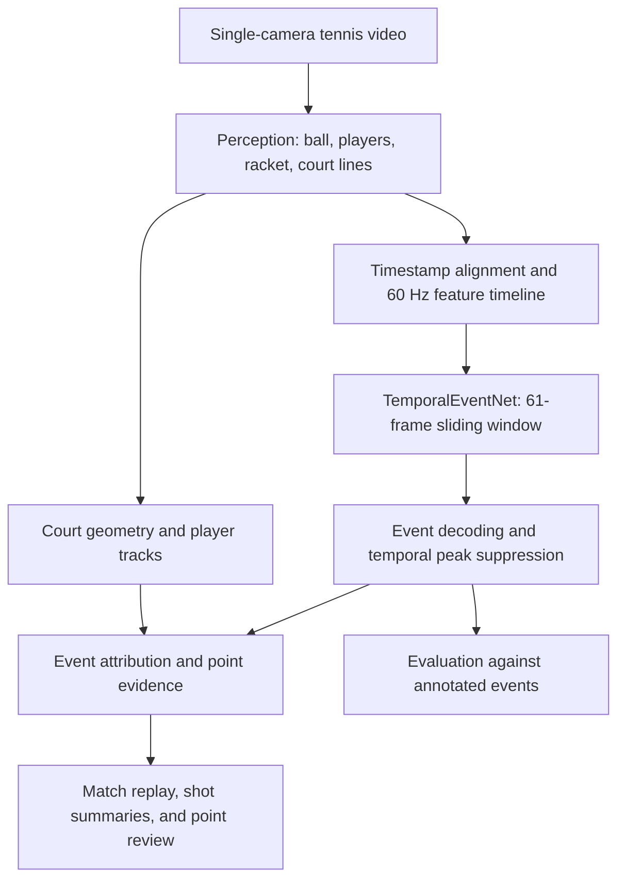

# Tenez Showcase

**Tenez is a computer vision system for tennis, built at Axio Labs.** It analyzes single-camera match footage to locate ball and player movement, identify tennis events, and turn them into a replay that players can review. The research question is how reliably a system can infer events from a fast, partially occluded ball when the camera supplies an incomplete view of the court.

## System architecture

The perception stages extract ball and racket observations, player tracks, and court landmarks. The event pipeline aligns time-stamped observations on a **60 Hz working timeline**. This is the model's sampling grid. Camera frame rate and inference throughput are measured separately.

**TemporalEventNet** uses a bidirectional LSTM to classify the center sample of a **61-frame sliding window**. The window covers one second from first to last sample, with half a second of context on either side. Streaming use of this centered model requires buffering the future half. A temporal decoder suppresses nearby duplicate proposals before downstream logic attributes events and assembles point evidence.

Court geometry maps ground-plane observations to court coordinates for placement and replay. When a bounce or point ending lacks sufficient evidence, the analysis can leave the outcome unresolved for review.

## Evaluation and data provenance

- **Recording-level partitions.** Clips and overlapping windows from the same original recording belong to the same partition. Derived views inherit the recording's role.
- **Checkpoint lineage.** Record the training and validation exposure, dataset manifest fingerprint, and decoder configuration. Check lineage before treating a recording as held out, including exposure through pretrained or warm-start checkpoints where the source history is available.
- **Development and blind testing.** A recording used for threshold, architecture, or checkpoint selection counts as development data even when it was excluded from gradient updates. A blind evaluation requires an independent recording reserved before those decisions.
- **Candidate selection.** Compare candidates using the same decoder and annotation protocol. Require validation improvement and check for per-recording regressions before replacing the baseline.

### Event-detection benchmark

On one annotated match recording used for development selection, the temporal model and a higher-recall candidate were evaluated with the same decoder. The benchmark matches predictions to same-class annotated events within five timeline frames (approximately 83 ms) and counts each annotated event at most once.

| Model | Event proposals | Precision | Recall | F1 | Macro F1 |
| --- | ---: | ---: | ---: | ---: | ---: |
| Selected TemporalEventNet | 370 | 59.73% | 32.55% | 42.14% | 26.39% |
| Higher-recall candidate | 1,076 | 33.18% | 52.58% | 40.68% | 21.00% |

Precision is the share of predictions that match an annotation. Recall is the share of annotations recovered. F1 is their harmonic mean, and macro F1 gives each evaluated class equal weight. The higher-recall candidate recovered more events but produced enough false positives to lower F1. The selected model retained the higher F1 under the common decoder.

These figures measure **event class and timing on development footage**. Generalization to new courts and camera angles, end-to-end scoring, line-call accuracy, calibrated ball speed, and mobile latency require separate evaluation.

## Authors & Contributors

- **Sourabh Lamba** ([@SourabhLamba](https://github.com/SourabhLamba))
- **Ritika Gaur** ([@ritikagaurwork-cpu](https://github.com/ritikagaurwork-cpu))

## Copyright

© 2026 Axio Labs. All rights reserved. This public repository contains the showcase documentation. The application source, model weights, training pipeline, datasets, and match recordings are confidential.
